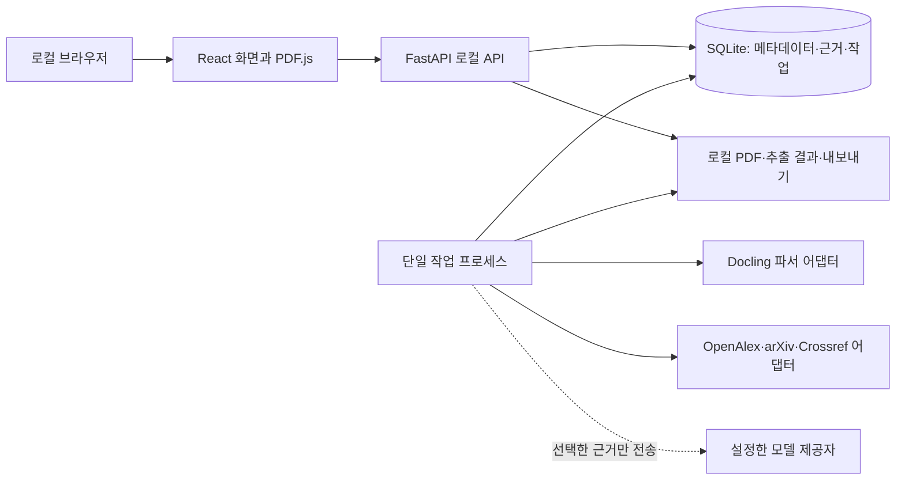

# EasyResearch 구현 우선순위와 레퍼런스 조사

조사일: 2026-10-28, Asia/Seoul  
대상: Windows에서 혼자 쓰는 연구 작업 공간. 한국어로 질문하고 주로 영어 논문을 읽는다는 기존 가정을 유지한다. 관심 분야, 논문 수, 개인정보 수준과 모델 예산은 아직 사용자에게 확인되지 않았다.

이 문서는 [기존 기획과 설계](research-assistant-feasibility-and-implementation.md)의 후속 결정이다. 첫 버전의 아키텍처와 순서가 서로 다르면 **이 문서를 우선**한다. 기존 문서는 기능의 장기 목표와 상세 배경으로 보존한다. 여기의 선택은 공식 문서와 공개 저장소를 읽고 내린 설계 판단이다. 후보를 설치해 같은 논문으로 성능을 비교하거나 API 비용을 실측하지는 않았다. 저장소의 기능 설명은 해당 프로젝트의 주장이고, 별 수와 릴리스는 조사 시점의 신호일 뿐 품질 보증이 아니다.

## 1. 결론과 제품 범위

**첫 완성품은 내가 가진 논문 PDF를 저장하고, 원문을 확인하면서 읽고, 메모와 근거를 프로젝트에 남기는 로컬 웹앱으로 만든다.** PDF 근거를 신뢰할 수 있게 저장한 뒤 검색·AI 설명을 붙인다. 그 다음 논문 비교, 아이디어 연결, 자동 실험으로 확장한다.

1. PDF 업로드 → 원본과 버전 저장 → 텍스트·페이지 추출 → PDF에서 페이지 열기 → 메모와 직접 지정한 근거 저장.
2. 그 위에 OpenAlex·arXiv 검색, DOI 확인, 읽기 목록과 내보내기 추가.
3. 같은 근거 저장소를 이용해 질의응답·구조화 분석·논문 비교 추가. 근거가 부족하면 답변하지 않거나 미확정으로 표시.
4. 재현 가능한 소규모 CPU 실험과 Codex 연결을 별도 단계로 추가. 이후 Claude와 병렬 에이전트는 실제 필요와 비용을 확인한 뒤 연결.

**첫 실행 구성:** React + TypeScript + Vite, Python 3.12 + FastAPI, SQLite + FTS5, 로컬 파일 저장, 별도 단일 작업 프로세스, Docling 후보와 PDF.js. 단일 사용자·단일 컴퓨터에 맞춘 출발점이다. Postgres·Redis·RQ·Docker Desktop·WSL2는 처음 앱을 켜는 필수 조건에서 제외한다. 연구 코드 실행 단계의 격리와 팀 사용 단계의 확장은 별도로 다룬다.

**최초 개발 작업:** 실제 논문 10~20편으로 Docling 출력의 페이지·구절을 검증하는 작은 수직 기능을 만든다. 검증할 PDF가 아직 없으므로 공개적으로 접근 가능한 논문과 사용자가 제공하는 PDF를 준비하는 작업이 선행된다. 이 검증이 불충분하면 앱 전체에 분석 기능을 붙이기 전에 파서나 근거 저장 방식을 바꾼다.

## 2. 기존 설계에서 바꾼 결정

| 항목 | 기존 제안 | 이번 결정과 이유 |
|---|---|---|
| 데이터베이스 | PostgreSQL + pgvector | 1인 첫 버전은 SQLite + FTS5. 설치와 백업 부담을 줄이고 명시적 저장소 경계로 나중에 이전한다. |
| 작업 큐 | Redis + RQ | DB에 기록되는 단일 별도 작업 프로세스. 사용자가 처리량 또는 재개 요구를 확인하면 전용 큐를 비교한다. RQ 기본 워커는 Windows의 fork 제약을 고려해야 한다. [RQ 문서](https://python-rq.org/docs/workers/) |
| 운영 환경 | WSL2 + Docker Desktop 중심 | 첫 읽기 앱은 Windows 네이티브를 목표로 한다. Docling의 설치·모델 실행은 실제 기기에서 먼저 검증하고 실패하면 WSL2를 대안으로 검토한다. Docker는 실험 실행 단계에서 별도 도입한다. |
| 검색 | 시작부터 pgvector·BGE-M3 | FTS5 키워드 검색으로 기준선을 만든다. 다국어 의미 검색은 평가셋에서 실제 개선이 확인될 때 추가한다. |
| PDF 분석 | Docling을 사실상 확정 | Docling을 1순위 후보로 두되 10~20편에서 검증 후 결정한다. 수식·표·스캔은 실패할 수 있다. |
| 자동 연구 | Codex·Claude·서브에이전트 병행 | 앱의 근거·작업 기록이 갖춰진 뒤 Codex 한 제공자와 작은 CPU 실험부터 시작한다. |
| Zotero | 파일 가져오기 후 Web API | BibTeX/CSL JSON 가져오기를 우선하고, 사용 여부가 확인되면 읽기 전용 Local API를 별도 검증한다. |

SQLite WAL은 같은 호스트의 로컬 파일에서 운영하며 네트워크 공유 폴더를 피한다. 읽기와 쓰기는 동시에 가능하지만 쓰기 트랜잭션은 한 번에 하나다. Python에 포함된 SQLite의 실제 버전을 실행 시 확인한다. SQLite는 드문 WAL 손상 오류를 3.51.3 이상에서 수정했고 일부 구버전에는 3.44.6, 3.50.7로 수정이 백포트됐다. 따라서 **검증된 수정 버전**을 갖춘 런타임을 사용해야 하며 Python 버전만으로 판단하지 않는다. [SQLite WAL](https://www.sqlite.org/wal.html)

## 3. 이 PC에서 확인한 출발 조건

2026-10-28 현재 PATH에서 Python 3.9.13, Node.js 24.13.0, npm 11.6.2, Docker CLI 29.5.2, WSL 명령을 확인했다. `uv`와 Python Launcher `py`는 PATH에서 찾지 못했다. 현재 Python의 SQLite는 **3.37.2**로 위 WAL 수정 버전이 아니다. 다른 Python 설치 여부는 확정하지 못했다. Docker 엔진 실행 여부, WSL 배포판, GPU, 메모리와 가용 디스크도 확인하지 못했다. 하드웨어 질의는 접근이 거부됐다.

개발 시작 시 Python 3.12 환경과 `uv`를 준비하고, 해당 환경의 `sqlite3.sqlite_version`, FTS5 및 Docling 설치·실행을 별도 확인한다. Node는 실제 설치할 Vite 버전의 요구사항을 확인한 뒤 고정한다. [uv Python 관리](https://docs.astral.sh/uv/guides/install-python/), [Vite 안내](https://vite.dev/guide/). 이 문서 작성 중 개발 도구를 설치하거나 설정을 바꾸지는 않았다.

## 4. 첫 버전 구성



프로세스는 UI, API, 작업자 세 역할을 갖되 API와 작업자를 한 실행 명령으로 함께 시작할 수 있게 만든다. 문서 변환은 API 요청 처리 중에 직접 수행하지 않는다. UI는 저장된 상태를 먼저 읽고 작업 진행은 주기적으로 확인한다. 1차에서는 모델과 인터넷이 없어도 저장한 PDF·메모를 열 수 있어야 한다.

권장 디렉터리는 다음과 같다. 첫 작업에서 모든 폴더를 빈 껍데기로 만들 필요는 없다.

```text
EasyResearch/
  apps/web/                  # React, PDF 뷰어
  services/api/app/
    api/                     # HTTP와 입력 검증
    domain/                  # 논문, 파일, 근거, 작업 규칙
    storage/                 # SQLite, 파일, 마이그레이션
    ingestion/               # PDF 파서 인터페이스와 Docling
    sources/                 # OpenAlex, arXiv, Crossref
    retrieval/               # 키워드, 이후 선택적 벡터 검색
    analysis/                # 근거 기반 생성과 검증
    jobs/                    # 작업 수명주기와 단일 워커
    providers/              # 모델·에이전트 어댑터, 필요한 시점에 추가
  docs/                      # 설계와 조사
  data/                      # 사용자 데이터, Git 추적 제외
  eval/                      # 평가셋 정의와 결과. 저작권 있는 PDF는 Git 제외
```

### 저장 모델

| 레코드 | 핵심 내용과 규칙 |
|---|---|
| `projects`, `project_papers` | 프로젝트 질문과 범위, 프로젝트별 읽기 상태. 한 논문을 여러 프로젝트에서 사용. |
| `papers`, `paper_identifiers`, `paper_sources` | 서지 정보, DOI/arXiv ID, 제공자 ID와 원 응답·수집 시각. DOI 정규화 후 정확히 같은 경우와 동일 파일 해시는 자동 중복 후보로 처리. 제목 유사성만으로 자동 합치지 않는다. |
| `paper_versions`, `files` | 프리프린트·출판본을 구분하고 실제 PDF의 SHA-256, 로컬 경로, 수집 시각과 관계를 저장. 원본은 덮어쓰지 않는다. |
| `extraction_runs`, `pages`, `evidence_spans` | 파서·버전·옵션·상태, 파일별 **0부터 시작하는 PDF 페이지 인덱스**, 표시 페이지 라벨, 페이지 크기·회전·좌표계·원문/정규화 텍스트·출처와 신뢰 상태. 좌표는 검증된 경우만 하이라이트. |
| `notes`, `claims`, `claim_evidence` | 개인 메모와 AI 생성 주장을 구분. 주장과 근거는 다대다로 연결하고 저자의 주장, 저자가 인정한 한계, 시스템 해석을 구분. 사용자 수정과 과거 생성 버전을 보존. |
| `jobs`, `job_events`, `artifacts` | 단계, 상태, 시도, 오류, 취소 요청, 작업자 lease, 출력 경로와 해시. 실패·중단 기록도 보존. |
| `search_runs`, `search_results` | 검색어, 소스, 필터, 날짜, 상태, 결과 ID, 실패·제한 정보를 보존. 초록만 있는 항목은 표시. |

Docling의 구조화 문서 모델은 페이지 및 위치 출처를 표현한다. 그 좌표가 모든 PDF에서 정확하게 렌더링된다는 뜻은 아니므로 원본 JSON과 좌표계 정보를 보관하고 PDF.js와 대조한다. [Docling 문서 모델](https://docling-project.github.io/docling/reference/docling_document/), [PDF.js](https://github.com/mozilla/pdf.js)

### 작업과 복구

`queued → running → completed/failed/cancelled`를 기본 상태로 두고 필요한 경우 `awaiting_user`와 `budget_limited`를 추가한다. 작업 생성과 입력 기록을 한 DB 트랜잭션으로 저장한다. 작업자는 짧은 원자적 트랜잭션으로 한 작업을 선점하고 lease와 heartbeat를 갱신하며 긴 PDF 변환 자체는 트랜잭션 밖에서 실행한다. 앱 재시작 시 만료된 lease를 점검하고 완료된 파일과 체크포인트를 검증한 다음 재시도 또는 실패 상태로 전환한다.

출력은 임시 경로에 쓰고 완료 후 원자적으로 이름을 바꾼 뒤 해시와 함께 등록한다. 같은 요청은 멱등성 키로 중복 등록을 방지한다. 취소 시 작업자뿐 아니라 자식 프로세스도 종료·정리한다. 외부 모델 호출의 결과가 불확실한 경우 중복 비용이 생길 수 있으므로 자동 재호출 전에 상태를 표시한다. 앱 상태, 모델 세션, 실험 프로세스는 서로 다른 기록이며 세션 재개가 실행 중이던 프로세스의 복원을 보장하지 않는다.

PDF 수신도 임시 파일에 저장하고 크기·해시를 확인한 뒤 최종 경로에 옮겨 DB에 등록한다. 파일 이동과 DB 트랜잭션은 하나의 원자적 작업이 아니므로 중간 장애로 남은 고아 파일이나 누락된 파일을 재시작 시 찾아 복구 또는 사용자에게 알린다.

백업은 SQLite의 [온라인 백업 API](https://www.sqlite.org/backup.html)로 일관된 DB 사본을 만들고 PDF·산출물과 manifest를 함께 보존한다. 복원은 별도 경로에서 열어 파일 해시와 연결을 확인한다. WAL 사용 중 DB 파일 하나만 임의로 복사하는 방식에 의존하지 않는다.

### 로컬 접근과 데이터 전송

API는 기본적으로 `127.0.0.1`에만 바인딩한다. 다른 웹사이트가 로컬 API를 호출하거나 변경 요청을 보내지 못하도록 허용 Origin, Host 검증과 변경 요청 보호를 설계하고 파일 경로는 앱이 관리하는 디렉터리로 제한한다. 모델 제공자 호출 시 어떤 PDF의 어떤 발췌가 외부로 전송되는지 표시하고 선택하게 한다. 키는 서버 측 설정에 보관하고 Git, 화면 번들, 로그 및 실험 실행 환경에서 제외한다.

## 5. 실제 구현 순서와 완료 기준

시간보다 통과 조건을 우선한다. 예상 기간은 개발 환경과 PDF 종류가 정해지지 않아 지금 확정하지 않는다.

### 0단계: 근거 검증용 세로 기능

1. Windows에서 Python 3.12와 수정된 SQLite, Node, Docling을 준비하고 버전을 기록한다. Docling이 실행되지 않으면 원인과 WSL 대안을 기록한다.
2. 10~20편의 평가용 PDF를 목록화한다. 2단 논문, 표·수식, 이미지 스캔, 부록, 인쇄 페이지와 실제 페이지가 다른 문서를 포함한다. 파일의 접근 권한과 출처를 기록하고 원문은 공개 저장소에 올리지 않는다.
3. PDF 원본 해시, Docling 원본 결과, 페이지·텍스트를 저장하고 PDF.js로 지정 페이지를 여는 최소 화면을 만든다. 수동으로 선택한 구절을 근거로 저장한다.
4. 각 PDF에서 읽기 순서, 페이지 일치, 구절 재발견, 표·수식 손상, 추출 실패, 처리 시간과 메모리를 기록한다. 일부 페이지만 실패해도 표시한다.

**통과:** 표본의 각 근거를 사용자가 해당 원문 페이지에서 찾을 수 있고, 파싱 실패가 숨겨지지 않으며, 같은 파일을 다시 열어 근거를 복원할 수 있다. 좌표 정확도가 부족하면 페이지 이동만 제공하고 하이라이트는 보류한다. Docling이 실패한 문서는 같은 기준으로 Marker 또는 MinerU를 비교하고, 속도·자원·라이선스까지 고려해 선택을 바꾼다.

### 1단계: 개인 논문 보관함

프로젝트 생성, PDF 등록·중복 감지, 제목/저자 수동 수정, 읽기 상태, 메모, 페이지 근거, 검색, Markdown·JSON·BibTeX 내보내기, 백업과 복원. 수동 PDF 등록이 막히면 전체 기능이 막히므로 메타데이터 API나 모델 키 없이 작동하게 한다.

**통과:** 재시작 후 프로젝트·PDF·근거·메모가 유지되고, 같은 PDF 재등록 시 중복을 알아볼 수 있다. 백업을 다른 폴더에 복원하여 PDF와 근거 페이지가 다시 열린다. 새 버전 PDF는 기존 파일을 덮어쓰지 않는다.

### 2단계: 논문 검색과 가져오기

OpenAlex 검색을 우선 구현하고 arXiv 검색과 Crossref DOI 확인을 별도 어댑터로 추가한다. 검색식·날짜·소스·필터와 결과를 보존하고, 사용자가 결과를 저장·제외·수정할 수 있게 한다. 공개 PDF 위치는 후보로 표시하고 사용 가능한 원문 여부를 확인한다. 사전 인쇄본과 출판본은 관계로 연결하고 자동 병합하지 않는다.

**통과:** 알려진 질문 10개와 이미 아는 관련 논문 10~20편을 사용해 상위 결과·누락·중복·시간·요청량을 기록한다. 한 소스가 429/오류를 반환해도 다른 검색 결과와 저장된 문서는 이용 가능하다. 이는 전체 검색 재현율 증명이 아니라 자신의 사용 사례에 대한 기준선이다.

OpenAlex는 기본 검색에 무키 사용이 가능하며 무료 키가 일일 예산과 사용량 확인에 도움이 되고 커서 페이지 이동에 필요하다. 계정 무료 예산은 조사 당시 하루 $1 상당이며 정책은 바뀔 수 있다. 소스별 비용·쿼터·호출 실패를 표시하고, 속도 제한과 일일 예산 소진을 구분해 무한 재시도하지 않는다. [인증](https://help.openalex.org/api/authentication/), [요금](https://help.openalex.org/access/pricing/), [비용 예시](https://help.openalex.org/access/example-costs/), [오류](https://help.openalex.org/api/errors/), [Crossref 접근 정책](https://www.crossref.org/documentation/retrieve-metadata/rest-api/access-and-authentication/), [arXiv API](https://info.arxiv.org/help/api/user-manual.html)

### 3단계: 근거 기반 분석과 비교

저장된 본문에서 키워드 검색으로 근거 후보를 찾고, 그 발췌만 모델에 전달해 한국어 설명을 만든다. 출력은 주장별 근거 ID, 실제 발췌, 파일·페이지와 함께 저장한다. 구절 존재 검사와 사람이 판단하는 의미 지지 검사는 별도로 기록한다. PDF가 없으면 초록 기반임을 표시한다. 원문 부족 시 추측으로 채우지 않는다.

사용자 질문과 정답 근거를 미리 적은 한영 질문 20개 이상을 만들어 키워드 검색을 기준선으로 기록한다. 관련 근거가 검색 상위에 들어오는 비율, 지원되지 않은 질문에 대한 거절, 근거 페이지 정확성, 사람이 본 주장 지지율, 비용과 시간을 측정한다. 벡터 검색 및 재정렬은 동일 질문·동일 문서로 비교해 유의미한 개선이 있을 때 도입한다. FTS5의 기본 토큰화가 한국어 형태소 분석을 제공한다고 가정하지 않으며, 짧은 검색어 및 한국어 검색 한계를 평가한다. [SQLite FTS5](https://www.sqlite.org/fts5.html)

비교표에는 데이터셋 버전, 분할, 지표·단위, 방법, 학습 및 평가 조건과 원문 페이지를 함께 저장한다. 조건이 다르면 순위를 매기지 않고 차이를 표시한다. 사용자가 정정한 내용은 재생성으로 덮어쓰지 않는다.

**통과:** 핵심 주장마다 확인 가능한 근거 또는 근거 부족 상태가 있고, 임의 추출된 주장 50개에 대해 구절 존재·페이지 일치와 의미 지지율을 별도로 기록한다. 인용 링크 존재를 사실 정확도의 증거로 삼지 않는다.

### 4단계: 아이디어와 관계

논문·개념·아이디어·질문 사이에 사용자가 직접 관계와 근거를 연결한다. 자동 제안은 제안 상태로 두고 승인·수정·삭제가 가능해야 한다. 우선 현재 항목 주변 목록을 만들고 그래프 화면은 실제 탐색 불편이 확인되면 추가한다. 관계와 인용은 동일한 의미가 아니다.

### 5단계: 제한된 연구 실행

Codex 한 제공자로 고정된 작은 CPU baseline을 실행·기록한다. 단계별 산출물, 코드 commit/diff, 데이터와 분할 해시, 이미지 digest, 명령, 의존성, seed, 지표, 로그, 종료 상태를 보존한다. 모델이 변경하는 코드와 평가 데이터·평가 코드를 분리한다. 이후 Claude 검토, 서브에이전트, MLflow 등은 평가 결과와 실제 필요에 따라 추가한다.

**통과:** 같은 입력·환경에서 재실행한 결과를 비교할 수 있고, 프로세스 강제 종료·취소 후 상태와 산출물의 정합성을 확인할 수 있다. 예산·시간 초과 및 외부 호출 실패를 남긴다.

## 6. 첫 개발 백로그

| 순서 | 작업 | 결과물과 완료 조건 | 선행 |
|---:|---|---|---|
| 1 | 개발 환경과 버전 확인 | Python 3.12, 수정된 SQLite 및 FTS5, Node 버전 기록. 실행 불가 항목의 대안 기록 | 없음 |
| 2 | 평가 문서 목록 작성 | PDF 10~20편, 구조 유형, 파일 해시, 1~2개 확인 구절/페이지를 보관. 원문 Git 제외 | 1 |
| 3 | 최소 API·저장소 | 프로젝트, 논문, 파일, 작업 스키마와 마이그레이션. 입력과 파일 저장 후 재시작 확인 | 1 |
| 4 | PDF 등록·원본 보존 | 업로드 제한, 해시, 파일 경로, 중복 후보, 원본 버전 기록 | 3 |
| 5 | 단일 작업자 | 영속 작업, 선점·heartbeat·취소·실패 상태, 중단 복구 | 3 |
| 6 | Docling 변환 어댑터 | 파서 버전, 원본 출력, 페이지·발췌·실패 상태 저장 | 2, 4, 5 |
| 7 | PDF 뷰어와 근거 저장 | 근거 클릭 시 원문 페이지 이동, 페이지 라벨·인덱스 구분 | 6 |
| 8 | 표본 평가 및 파서 결정 | 표본별 결과·오류·시간을 기록하고 Docling 유지 또는 대안 선택 | 7 |
| 9 | 읽기 목록·메모·내보내기 | 프로젝트별 상태와 사용자 메모, Markdown/BibTeX/JSON | 8 |
| 10 | 백업·복원 | DB와 PDF·manifest를 별도 폴더로 복원하고 연결 확인 | 9 |
| 11 | OpenAlex 검색 | 검색식·예산·오류·결과 기록, 선택 저장 | 9 |
| 12 | arXiv·Crossref | ID 정규화와 제공자별 결과·버전 관계 | 11 |
| 13 | 검색 평가셋 | 한영 질문·정답 근거, 키워드 기준선과 실패 기록 | 8, 12 |
| 14 | 근거 기반 분석 | 발췌 전송 범위 표시, 주장·근거 검증, 부족 시 거절 | 13 |
| 15 | 비교표 | 비교 조건·원문 근거·비교 불가 상태 | 14 |

각 기능은 UI·API·저장을 관통하는 작은 단위로 완성한다. 1~8이 끝나기 전에 그래프나 자동 실험부터 만들지 않는다.

## 7. 조사한 저장소와 채택 판단

조사는 README, 공식 문서, 릴리스·라이선스 페이지를 중심으로 했다. 기능과 라이선스는 업데이트될 수 있으므로 코드를 가져오거나 의존성을 추가하기 직전에 고정 버전의 실제 라이선스와 하위 모델 라이선스를 재확인한다. 아래는 **읽고 비교할 순위**이며 전체 코드를 복사하거나 이 레포들이 검증된 성능을 보장한다는 뜻은 아니다.

| 우선 | 저장소 | 확인한 강점과 EasyResearch에서 볼 부분 | 판단과 제약 |
|---:|---|---|---|
| 1 | [PaperSeek](https://github.com/paperseek/paperseek) | Apache-2.0. 질문→검색식→소스별 검색→인용 확장·정렬, 검색 이력, 취소·복구, 소스별 속도 제한. SQLite 기반 Community 구성이 참고가 된다. | 검색 과정 UI와 어댑터 설계의 최우선 참고. 1.0 베타이며 초록 기반 리뷰는 실험적이다. 전체 통합은 보류. |
| 2 | [Provenote / doc_assistant](https://github.com/ldele/doc_assistant) | Apache-2.0. 로컬 문서·원문 페이지 연결·근거 기반 답변·평가 체계. Windows를 지원한다고 명시. | PDF 근거 UX와 평가 기록을 읽는다. 자체 평가 수치를 우리 문서의 정확도로 일반화하지 않는다. |
| 3 | [Paper Pilot](https://github.com/Xueyang-Song/paper-pilot) | MIT. 로컬 프로젝트·논문·메모·검색과 FTS5/벡터 검색. | 논문 정리 및 전체 흐름 비교. Windows [설치 안내](https://xueyangsong.com/apps/paper-pilot/)는 있으나 이 PC에서 실행하지 않았다. |
| 4 | [PaperQA2](https://github.com/Future-House/paper-qa) | Apache-2.0. 과학 문서 질의응답과 근거 추출. [2026-08-12 릴리스](https://github.com/Future-House/paper-qa/releases) 확인. | 3단계의 RAG 비교 기준과 코드 참고. 논문 평가 환경과 공개 패키지의 차이를 고려하고 직접 동일 조건으로 평가한다. |
| 5 | [Nodus](https://github.com/jorgepb96/nodus) | AGPL-3.0-only. 소스·노트·아이디어·Zotero 연결, Windows 지원. [2026-10-25 릴리스](https://github.com/jorgepb96/nodus/releases) 확인. | 프로젝트와 관계 UX 참고. 소스 복사·통합 전 AGPL 조건을 검토한다. |
| 6 | [RAG Assistant for Zotero](https://github.com/Quiet-Signals-Lab/RAG-Assistant-for-Zotero) | GPL-3.0-or-later. Zotero 라이브러리 검색, 근거와 페이지, 로컬 모델 선택, Windows 지원. | 라이브러리 읽기와 출처 UI 참고. 스캔 PDF는 OCR이 필요하며 코드 사용 전 GPL 조건 확인. |
| 7 | [Docling](https://github.com/docling-project/docling) | 코드 MIT. 문서 구조·페이지·좌표 보존, OCR·표 추출. [릴리스](https://github.com/docling-project/docling/releases) 확인. | 첫 PDF 파서 후보. 모델과 OCR 구성의 라이선스 및 실제 기기 자원은 별도 확인. |
| 8 | [GROBID](https://github.com/grobidOrg/grobid) | 논문 서지·참고문헌 구조화 및 [PDF 좌표](https://grobid.readthedocs.io/en/latest/Coordinates-in-PDF/). | 인용 그래프·참고문헌 처리 단계 후보. 별도 서비스 운영을 요구하므로 초기에 필수로 두지 않는다. |
| 9 | [MinerU](https://github.com/opendatalab/MinerU) | 레이아웃·OCR·수식 처리 대안. 활발한 프로젝트지만 자원 요구가 높고 [별도 라이선스](https://github.com/opendatalab/MinerU/blob/master/LICENSE.md)가 있다. | 동일 PDF 벤치마크 후보. 소프트웨어·모델의 이용 조건과 장비 적합성을 확인한 뒤 선택. |
| 10 | [Marker](https://github.com/datalab-to/marker) | PDF 구조 변환 대안. 코드 라이선스와 [모델 라이선스](https://github.com/datalab-to/marker/blob/master/MODEL_LICENSE)를 따로 살펴야 한다. | Docling의 표·수식 실패 사례에 한해 같은 평가셋으로 비교. |
| 11 | [autoresearch](https://github.com/karpathy/autoresearch) | MIT. 고정 시간과 지표로 실험을 반복하는 패턴. | 단일 NVIDIA GPU 기반 LLM 학습에 특화되어 범용 실행기로 채택하지 않는다. 실험 예산과 비교 구조를 참고. |
| 12 | [AutoResearchClaw](https://github.com/aiming-lab/AutoResearchClaw) | MIT. 단계별 연구 산출물과 실험 루프. | 단계·실패 이력 참고. 자동 생성·검증 주장은 자체 설명이며 독립 성능 근거가 아니다. |
| 13 | [AI-Scientist-v2](https://github.com/SakanaAI/AI-Scientist-v2) | 에이전트 탐색과 실험 관리 참고. | 복잡도와 [변형 라이선스](https://github.com/SakanaAI/AI-Scientist-v2/blob/main/LICENSE)를 확인하고 장기 단계에서만 검토. |
| 14 | [MLflow](https://github.com/mlflow/mlflow), [DVC](https://github.com/treeverse/dvc) | 실험 기록·데이터 버전 관리. | 실험과 데이터 규모가 커졌을 때 도입 후보. 초기에는 DB와 파일 manifest로 시작. |
| 15 | [DBOS Python](https://github.com/dbos-inc/dbos-transact-py), [Temporal Python SDK](https://github.com/temporalio/sdk-python), [RQ](https://github.com/rq/rq) | 장시간 작업·재시도·재개에 대한 대안. | 단일 워커의 복구·처리량 한계가 실측되면 비교. 외부 API 호출과 파일 산출물의 멱등성은 어느 도구에서도 별도로 설계한다. |

참고 레포를 설치하거나 코드를 가져오지 않았다. 특히 GPL/AGPL 및 모델 가중치의 조건을 프로젝트 코드의 라이선스와 혼동하지 않는다.

## 8. 더 읽어야 할 구체적인 참고 자료

개발을 시작하면 해당 작업 직전에 다음 문서와 실제 소스를 읽는다.

1. **PDF 근거:** [Docling 문서 모델](https://docling-project.github.io/docling/reference/docling_document/), [Docling OCR 설정](https://github.com/docling-project/docling/blob/main/docs/concepts/OCR.md), [PDF.js](https://mozilla.github.io/pdf.js/getting_started/), [GROBID 좌표](https://grobid.readthedocs.io/en/latest/Coordinates-in-PDF/). 특히 페이지 번호 기준, 좌표 원점·회전, 표와 수식 처리.
2. **검색:** [OpenAlex 인증](https://help.openalex.org/api/authentication/), [검색](https://help.openalex.org/api/searching/), [가격](https://help.openalex.org/access/pricing/), [Crossref REST](https://www.crossref.org/documentation/retrieve-metadata/rest-api/), [arXiv API](https://info.arxiv.org/help/api/user-manual.html). PaperSeek의 소스 어댑터, 요청 속도 제한, 검색 이력 구현.
3. **Zotero:** [Local API](https://www.zotero.org/support/dev/web_api/v3/local_api), [Web API v3](https://www.zotero.org/support/dev/web_api/v3/basics). 사용자의 실제 Zotero 사용 여부를 확인하고 읽기 전용 가져오기와 변경·삭제 충돌을 설계한다.
4. **저장·작업:** [SQLite WAL](https://www.sqlite.org/wal.html), [FTS5](https://www.sqlite.org/fts5.html), [온라인 백업](https://www.sqlite.org/backup.html), [RQ 워커](https://python-rq.org/docs/workers/), [DBOS 아키텍처](https://docs.dbos.dev/architecture). 작업 중단과 재시작, 백업 일관성, 파일·DB 불일치를 확인한다.
5. **에이전트:** [Codex SDK](https://learn.chatgpt.com/docs/codex-sdk), [Codex App Server](https://learn.chatgpt.com/docs/app-server), [Claude Agent SDK 세션](https://code.claude.com/docs/en/agent-sdk/sessions), [Claude 권한](https://code.claude.com/docs/en/agent-sdk/permissions). SDK와 제품 인증·가격·권한 정책은 구현 직전에 다시 확인한다.
6. **실험:** [Docker 보안](https://docs.docker.com/engine/security/), [자원 제한](https://docs.docker.com/engine/containers/resource_constraints/), autoresearch의 고정 평가 루프, AI-Scientist-v2의 탐색 기록. 데이터·모델 접근 조건과 실험 재현 항목을 별도 검토한다.

## 9. 자동 연구 단계의 경계

초기 실험 실행 프로필은 네트워크 차단, 읽기 전용 코드·데이터, 쓰기 가능한 별도 출력 폴더, 비루트 사용자, CPU·메모리·프로세스·시간 제한, 고정 이미지 digest와 API 비밀키 미주입을 기본으로 한다. Docker 소켓이나 임의 컨테이너 생성 권한을 실험 코드에 넘기지 않는다. 컨테이너만으로 적대적 코드가 완전히 안전해진다고 가정하지 않고, 신뢰하지 않는 코드에는 더 강한 격리를 따로 검토한다.

Codex SDK·Claude SDK의 세션 재개와 앱의 단계 재개를 구분한다. Claude의 자동 승인 목록은 전체 도구 접근 차단과 동일하지 않으므로 실제 도구 제한과 OS 수준 접근 제한을 함께 구성한다. 실제 API/계정 사용 가능 여부와 각 제공자의 약관·요금은 통합 시 확인한다. 초기에는 사용자 승인 없이 장시간 무제한 실험을 시작하지 않도록 실행 범위, 비용 상한과 중단 기능을 화면에 둔다.

## 10. 아직 결론을 바꿀 수 있는 정보

- 주 연구 분야와 실제 논문 형식: CS·AI 중심인지, 생명과학 등 분야별 데이터베이스가 필요한지.
- 실제 라이브러리 규모와 Zotero 사용 여부: 수십 편인지 수천 편인지에 따라 검색·동기화 우선순위가 달라진다.
- PC 메모리·GPU·저장 공간: 로컬 OCR과 임베딩 모델을 동시에 돌릴 수 있는지 확인이 필요하다.
- 외부 모델로 발췌를 보내도 되는지, 월 예산이 얼마인지: 모델 제공자와 로컬 모델 선택에 직접 영향을 준다.
- 공개 배포 또는 상용화 계획: 직접 사용할 OSS 및 모델의 라이선스 판단에 영향을 준다.

이 정보가 없어도 0~1단계의 로컬 PDF·근거·메모 기능은 진행할 수 있다. 파서 품질, 정확도와 일정은 실제 표본을 측정한 뒤 갱신한다.
