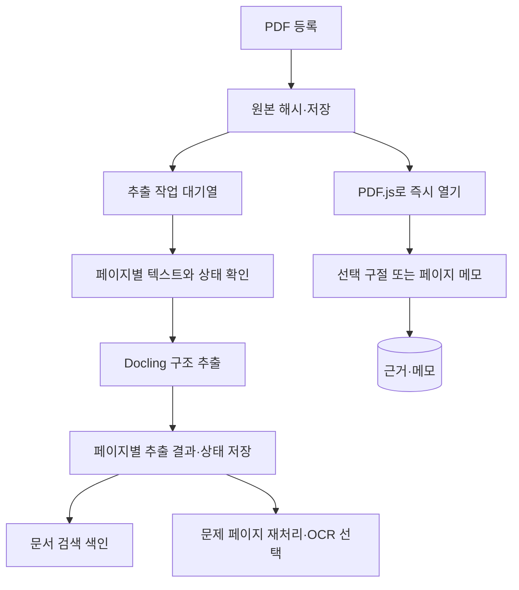

# PDF 읽기와 원문 근거 상세 설계

작성일: 2026-10-28, Asia/Seoul  
범위: 앞서 정한 첫 단계인 **PDF 등록 → 원문 읽기 → 근거와 메모 저장 → 다시 찾아보기 → 백업**. 기존 [구현 우선순위 문서](implementation-decisions-and-reference-review.md)의 PDF 관련 내용을 이 문서에서 구체화한다.

이 문서는 구현 명세이자 의사결정 기록이다. 공식 문서와 공개 저장소를 조사했지만 후보 프로그램을 이 PC에서 설치·실행하거나 같은 PDF로 성능을 측정하지 않았다. 코드·모델 버전, 실제 처리 속도와 품질은 첫 실험에서 결정한다.

## 1. 이번 단계의 핵심 결정

1. PDF 원본을 등록하면 **구조 추출이 끝나기 전에도 바로 읽을 수 있게 한다.** 텍스트 선택이 가능한 페이지에서는 구절을 수동 근거로 저장한다. 선택할 수 없는 페이지에는 페이지 메모를 남긴다.
2. PDF.js는 보기와 수동 선택을, 별도 작업 프로세스는 PDF 구조 추출과 검색 색인을 담당한다. Docling 실패가 원본 보기·수동 메모를 막지 않는다.
3. 근거는 **특정 PDF 파일 버전과 페이지에 연결**하고, 선택한 글·전후 문맥·가능한 위치를 함께 기록한다. 파서 재실행으로 사용자가 저장한 근거를 덮어쓰지 않는다.
4. 글자가 선택되지 않거나 표·수식 해석이 불확실하면, 사용자에게 그 상태를 보여주고 원문 페이지로 돌아갈 수 있게 한다. OCR 결과를 원본에서 정확히 추출된 글처럼 표시하지 않는다.
5. 무거운 Docling 분석과 OCR은 백그라운드에서 처리하고, 더 빠른 경로를 추가할지는 같은 PDF를 평가한 뒤 결정한다.
6. PDF와 DB가 서로 참조하는 상태를 백업·복원하고, 중단된 작업은 다시 시작할 수 있어야 첫 기능이 완성된 것이다.

이 단계의 산출물은 AI 답변이 아니라, 이후 분석도 안전하게 재사용할 **원문과 근거 저장 기반**이다. 단일 사용자·Windows·오프라인 로컬 사용을 기본으로 한다.

## 2. 실제 사용 흐름

### 2.1 처음 등록하고 읽기

1. 프로젝트에서 `PDF 추가`를 누르거나 PDF를 끌어놓는다. 파일은 앱이 관리하는 로컬 저장소에 복사한다. 원래 파일은 건드리지 않는다.
2. 크기·해시·형식과 열기 가능 여부를 확인한다. 이미 등록한 같은 파일이면 기존 항목을 보여주고 현재 프로젝트에 연결할 수 있게 한다. 제목이나 DOI가 비슷한 다른 파일은 사용자에게 후보로만 보여준다.
3. PDF가 열리면 뷰어에 곧바로 표시한다. 추출은 `대기`, `처리 중`, `완료`, `일부 실패`, `실패`로 별도 표시하고 진행 상태를 다시 볼 수 있게 한다.
4. 논문 제목·저자는 추출이나 자동 추측이 불확실할 때 직접 편집한다. 페이지 이동·확대/축소·문서 내 찾기와 최근 읽은 위치 복원을 제공한다.
5. 파서가 실패해도 PDF가 열리는 경우 읽기와 페이지 메모는 계속 가능하다. 암호가 필요한 PDF는 이를 알리고 암호 처리 지원 여부를 명시한다. 암호는 기본적으로 저장하거나 로그에 남기지 않는다.

### 2.2 구절 또는 페이지를 근거로 저장

1. 사용자가 PDF 텍스트 레이어에서 문구를 선택하고 `근거 저장`을 누른다. 선택된 문구와 정확한 문서·페이지를 확인할 수 있게 한다.
2. 메모와 종류를 선택적으로 입력한다. 종류는 주장, 방법, 결과, 한계, 질문 등을 제공하되 필수로 만들지 않는다.
3. 저장 후 근거 목록에서 해당 항목을 누르면 당시 PDF의 해당 페이지로 돌아간다. 위치가 확실하고 화면에서 검증된 경우에만 선택 위치를 표시한다.
4. 스캔·그림·표처럼 텍스트를 선택할 수 없으면 **페이지 메모**를 남긴다. 사용자가 직접 입력한 내용은 `사용자 메모`로 표시하며, 자동 추출된 인용문이라고 부르지 않는다.
5. 근거 저장과 수정 결과는 화면에 저장 성공 또는 실패를 표시한다. 쓰기 실패 시 입력한 메모를 화면에서 유지해 다시 저장할 수 있게 한다.

근거가 가리키는 원본 파일이 누락됐거나 좌표가 애매하면 이를 표시하고, 재지정할 수 있게 한다. 다른 파일 버전의 비슷한 문장을 자동으로 같은 근거라고 확정하지 않는다. PDF에 주석을 직접 쓰는 기능은 첫 단계에 넣지 않는다. 앱 DB의 메모와 PDF 파일 자체에 삽입된 주석은 다르다. [Zotero PDF Reader](https://www.zotero.org/support/pdf_reader)

## 3. 필요한 기능과 우선순위

| 우선순위 | 기능 | 이유와 완료 형태 |
|---|---|---|
| 필수 | PDF 추가·열기·중복 확인 | 파일 해시로 동일 파일을 알아보고 원본을 보존한다. |
| 필수 | 페이지 이동·확대·읽던 위치 복원 | 재시작 후 같은 논문의 마지막 위치로 돌아간다. |
| 필수 | 텍스트 선택 근거와 페이지 메모 | 텍스트 레이어가 없는 문서에서도 사용자가 근거를 남길 수 있다. |
| 필수 | 근거 목록과 원문 복귀 | 당시 파일·페이지를 정확히 열고 애매한 위치는 숨기지 않는다. |
| 필수 | 저장·추출 상태 및 실패 원인 | 원본 사용 가능 여부와 추출 성공 여부를 별도로 표시한다. |
| 필수 | 제목·저자 수정, 읽기 상태 | 잘못 추측한 메타데이터를 사용자가 고칠 수 있다. |
| 필수 | 중단 복구, 백업·별도 폴더 복원 | DB와 파일의 연결 및 해시를 확인한다. |
| 필수 | 삭제 복구와 참조 확인 | 프로젝트에서 제외와 원본 파일 삭제를 구분한다. 실수한 삭제는 휴지통에서 되돌릴 수 있게 한다. |
| 다음 | 파일 내부 검색과 검색 결과 페이지 이동 | 추출 결과별 출처를 표시한다. 검색 누락을 숨기지 않는다. |
| 다음 | 선택한 이미지 영역 근거 | 스캔·표·그림에서 사각형을 지정한다. 회전·크롭 복원이 검증된 뒤 추가한다. 그 전에는 페이지 메모로 처리한다. |
| 다음 | 페이지별 선택 OCR·부분 재처리 | 문제가 있는 페이지를 다시 분석하고 기존 수동 근거를 보존한다. |
| 다음 | 근거 유형·태그·여러 메모 연결 | 근거와 메모를 분리해 한 근거를 여러 아이디어에서 참조할 수 있다. |
| 이후 | Zotero 동기화, PDF 주석 파일 내보내기 | 사용 방식과 충돌 해결·파일 형식을 확인한 뒤 별도로 설계한다. |
| 이후 | AI 요약, 논문 비교, 그래프 | 원문 근거 모델과 평가 기준이 자리 잡은 뒤 추가한다. |

**첫 완료 화면**은 왼쪽에 논문 목록, 가운데 PDF, 오른쪽에 현재 논문의 근거·메모와 작업 상태를 두는 구성을 권장한다. 좁은 화면에서는 양쪽 패널을 접을 수 있게 한다. 단축키는 이후 실제 읽기 경험을 보고 정한다.

## 4. 처리 파이프라인과 효율화



### 4.1 기본 경로

- 등록 시 해시 계산과 기본 열기 검사는 스트리밍으로 처리한다. 화면은 원본이 안전하게 저장되고 열 수 있으면 사용 가능해진다.
- 사용자가 요청하지 않은 외부 모델 호출과 원격 OCR은 하지 않는다. Docling의 원격 서비스는 명시적으로 활성화해야 하며 최초 모델 다운로드와 오프라인 실패는 별도 상태로 다룬다. [Docling CLI](https://docling-project.github.io/docling/reference/cli/)
- 추출은 CPU 작업자 1개로 시작하고 각 문서·페이지의 결과와 실패를 기록한다. OCR·표·수식 처리에 쓰는 옵션과 모델 버전을 저장한다. 메모리·처리 시간이 확인되기 전 동시성을 늘리지 않는다.
- 문서 전체 상태와 페이지 상태를 분리한다. 시간 초과나 부분 변환을 전체 성공으로 처리하지 않는다. Docling의 옵션과 부분 성공 동작은 사용하는 버전에서 다시 확인한다. [Docling pipeline options](https://docling-project.github.io/docling/reference/pipeline_options/)
- 추출 캐시 키에는 파일 SHA-256, 파서·모델 버전, 옵션, 페이지 범위를 포함한다. 완전히 같은 입력과 설정의 완료 결과는 재사용한다. 설정이 바뀌거나 일부 페이지만 다시 처리하면 새로운 실행 기록을 남긴다.

### 4.2 빠른 경로의 판단

PDF.js 텍스트 레이어만으로 원문 보기와 수동 선택은 먼저 제공한다. 서버의 빠른 추출기로 [pypdfium2](https://github.com/pypdfium2-team/pypdfium2) 또는 [pdfplumber](https://github.com/jsvine/pdfplumber)를 추가할지는 **Docling 단독 경로와 같은 표본에서 비교한 뒤 결정**한다. 빠른 글자 추출은 2단 읽기 순서·표·수식 구조를 보장하지 않는다. 특히 PDF.js, 빠른 추출기, Docling의 글자 순서와 위치 오프셋은 서로 독립적이다.

비교 지표는 첫 페이지까지의 시간, 전체 추출 시간, 최대 메모리, 읽기 순서 오류, 근거 재발견, 표·수식 손상, 설치 부담이다. 같은 파일에서 냉간 실행과 모델이 이미 로드된 재실행을 구분한다. 가벼운 경로가 품질이나 운영 복잡도 대비 실익이 없으면 추가하지 않는다. PDFium을 직접 사용한다면 여러 스레드의 동시 호출에 안전하지 않으므로 같은 프로세스 안에서 직렬화하거나 프로세스를 분리해야 한다. [pypdfium2 API](https://pypdfium2.readthedocs.io/en/stable/python_api.html)

### 4.3 OCR과 큰 문서

페이지의 텍스트 유무·글자 품질·이미지 비율 등은 OCR 필요 여부를 제안하는 신호로 쓰되, 그 자체를 정확도 판정으로 취급하지 않는다. 스캔 페이지와 디지털 페이지가 섞인 PDF를 고려한다. 우선 원본을 그대로 보여주고, 문제가 있는 페이지의 OCR을 요청하거나 재처리할 수 있게 한다. 실제 임계값과 OCR 엔진별 한국어 지원은 평가 후 정한다.

뷰어는 현재 보이는 페이지와 가까운 페이지만 렌더링하고 벗어난 페이지의 캔버스·캐시를 해제하는 방향을 사용한다. 긴 문서에서 메모리와 스크롤 반응을 실측한다. [HYJI](https://github.com/inyoungoh-cde/hyji)는 PDF.js 기반 읽기와 관련 구현을 살펴볼 레퍼런스다. 기능은 저장소 설명을 확인했으며 이 PC에서 실행하지 않았다.

## 5. 근거가 원문에 정확히 돌아가는 방식

### 5.1 서로 다른 페이지 번호를 분리

| 항목 | 저장 규칙 | 예 |
|---|---|---|
| 내부 PDF 페이지 인덱스 | 0부터 시작하는 정수 | 첫 페이지 `0` |
| 뷰어 페이지 번호 | PDF.js가 요구하는 1부터 시작하는 번호로 변환 | 첫 페이지 `1` |
| 인쇄 또는 PDF 페이지 라벨 | 존재하는 경우 문자열로 보관. 자동 추출이 불확실하면 미확정 | `iv`, `1`, `S3` |
| Docling 페이지 참조 | 어댑터에서 사용하는 Docling 버전의 1 기반 페이지 번호를 내부 인덱스로 변환하고 원래 값도 보존 | `1 → 0` |

PDF에 표기된 쪽수와 파일의 물리적 페이지는 다를 수 있다. 화면에는 예를 들어 `파일 5쪽 · 인쇄 1쪽`처럼 구분한다. 없는 라벨을 추측하지 않는다. Docling CLI의 페이지 범위는 1부터 시작한다. [Docling CLI reference](https://docling-project.github.io/docling/reference/cli/)

### 5.2 선택을 기록하는 정보

각 근거는 `file_id`와 파일 SHA-256, 논문 버전, 근거 생성 방식, 페이지별 조각, 선택한 글 또는 페이지 메모, 생성·수정 시각을 갖는다. 텍스트를 선택한 경우 다음을 추가한다.

- 선택 당시의 **원래 문자열**과, 찾기용으로 별도 생성한 정규화 문자열 및 정규화 방식의 버전.
- 선택 전후의 짧은 문맥과 사용된 텍스트 레이어의 종류. 같은 문구가 여러 번 나타나는 경우를 구분하는 데 사용한다.
- 여러 줄·여러 페이지 선택을 위한 페이지별 사각형 배열. 단일 큰 사각형으로 여러 단을 덮지 않는다.
- 좌표 기준과 변환 버전, 페이지의 표시 영역·회전 정보, 선택 위치가 확인됐는지 여부.
- 파서가 생성한 근거라면 추출 실행 ID와 파서의 원본 출처. 수동 근거의 추출 실행 ID는 없어도 된다.

이는 텍스트와 앞뒤 문맥으로 위치를 식별하는 [W3C Web Annotation의 Text Quote Selector](https://www.w3.org/TR/annotation-model/#text-quote-selector)를 참고한 내부 설계다. 이 구조를 그대로 적용하는 것만으로 PDF 주석 표준 준수를 주장하지 않는다. PDF 텍스트 레이어의 선택 문자열도 글꼴 매핑이 잘못됐을 수 있으므로 사용자가 원문을 확인할 수 있게 한다.

### 5.3 위치 변환과 재연결

브라우저에서 선택된 화면 사각형은 페이지의 CSS 위치를 PDF.js viewport의 역변환으로 PDF 페이지 좌표에 옮겨 저장한다. 다시 표시할 때는 현재 페이지의 viewport 변환을 적용한다. 페이지의 CropBox/viewBox, 회전, 확대, 화면 픽셀과 캔버스의 devicePixelRatio를 구분하고, 줄별 사각형과 여러 페이지를 각각 처리한다. [PDF.js API](https://mozilla.github.io/pdf.js/api/draft/api.js.html)

파서가 제공한 bbox는 문단·표 전체의 위치일 수 있다. Docling의 좌표 원점과 페이지 기준은 PDF.js와 같다고 가정하지 않으며 변환 후 실제 원본 위에서 확인한다. 페이지에 정확히 이동할 수 있어도 구절 위치가 확인되지 않으면 하이라이트 대신 페이지 이동만 제공한다. [Docling document reference](https://docling-project.github.io/docling/reference/docling_document/)

텍스트 오프셋은 소스와 단위를 함께 저장한다. JavaScript의 UTF-16 코드 단위 오프셋을 Python의 Unicode 코드포인트 인덱스로 그대로 넘기지 않는다. 공백, 줄바꿈, 합자, 줄 끝 하이픈을 정규화할 때는 원문을 보존하고 매핑이 확인된 경우에만 해당 위치를 변환한다.

근거를 다시 열 때 순서:

1. 저장된 **같은 파일 해시와 페이지**를 확인한다. 다른 파일에 자동 연결하지 않는다.
2. 저장된 좌표가 같은 파일과 좌표 변환 버전에 유효하면 그 위치를 표시한다.
3. 좌표가 없거나 검증되지 않았으면 해당 페이지에서 원문과 전후 문맥을 검색한다. 파서·정규화 버전이 다르면 그 차이를 고려한다.
4. 정확한 후보가 하나이며 확인 가능한 경우에만 재연결 후보를 보여준다. 여러 후보 또는 일치 없음이면 자동 확정하지 않고 사용자가 고르게 한다.
5. 검색과 좌표가 모두 실패해도 원래 페이지와 저장된 메모는 보여주고 `위치 확인 필요`로 남긴다.

페이지와 위치 상태는 `사용자 확인`, `추출 결과`, `OCR 결과`, `위치 불명`처럼 출처와 검증 여부를 별도로 표현한다. 이 상태는 사실 여부를 보장하는 점수가 아니다.

## 6. 데이터와 파일 구조

| 테이블 | 중요한 필드와 관계 |
|---|---|
| `papers` | 논문의 제목·저자와 사용자가 수정한 메타데이터. |
| `paper_versions` | 논문 ID와 버전 정보. 프리프린트·출판본 등은 별도 버전으로 보존. |
| `files` | 파일 ID, SHA-256, 크기, 앱 내부 저장 키, 상태. 동일 파일 해시는 한 번 보관하고 버전과의 연결은 별도로 관리. |
| `version_files` | 논문 버전과 실제 파일의 관계. 같은 파일을 여러 프로젝트에서 참조할 수 있다. |
| `extraction_runs` | 파일, 파서와 모델 버전, 설정, 페이지 범위, 시작·종료, 성공/부분 성공/실패, 산출물 해시. |
| `extraction_pages` | 실행 ID, 0 기반 페이지, 표시 라벨, 크기·회전, 텍스트 출처, 원본 및 정규화 텍스트, 상태. 실행과 페이지 조합은 유일. |
| `evidence` | 근거 ID, 논문 버전·파일, 종류, 생성 방식, 검증 상태, 생성·수정 시각. 추출 실행은 수동 근거에서 선택 사항. |
| `evidence_fragments` | 근거별 페이지 인덱스, 선택 글·전후 문맥, 사각형 배열, 좌표계·변환 버전. 여러 페이지의 선택은 여러 행으로 표현. |
| `notes`, `evidence_notes` | 메모와 근거 연결을 분리. 여러 메모가 같은 근거를 가리킬 수 있다. |
| `reading_positions` | 프로젝트·논문 버전별 마지막 페이지와 확대 설정. |
| `jobs`, `job_attempts`, `job_events` | 추출 요청, 각 시도와 lease, 상태 변경·오류·취소 이력. |

`evidence`가 가리키는 파일이 해당 논문 버전에 연결돼 있고 페이지 인덱스가 실제 범위 안에 있는지 검증한다. 페이지가 두 개 이상인 근거는 조각 전체를 한 트랜잭션에서 저장한다. 사용자의 수정 이력과 추출 결과를 구분하고, 원본 PDF는 수정하지 않는다. 보관 파일의 실제 경로는 API 응답에 노출하지 않는다.

```text
data/
  library.sqlite3
  files/<sha256-prefix>/<sha256>.pdf
  runs/<file-id>/<run-id>/       # 원본 구조화 결과와 manifest
  tmp/<job-id>/<attempt-id>/     # 미완료 작업, 복구·정리 대상
  backups/                       # 사용자가 지정하는 위치도 지원
```

파일명은 사용자가 보낸 경로를 쓰지 않고 서버에서 생성한다. 파일과 실행 산출물은 불변으로 취급한다. 삭제는 먼저 참조와 휴지통 상태를 기록하고, 다른 프로젝트·근거·백업에서 사용하지 않는지 확인한 뒤 정리한다. DB와 파일 시스템의 저장은 한 번에 원자적으로 완료되지 않으므로, 중단 후 빠진 파일과 고아 임시 파일을 점검한다.

SQLite는 로컬 파일에서 WAL을 사용하고 각 연결에 외래키 검사를 켠다. 사용자 메모 보호를 위해 `synchronous=FULL`을 기본 후보로 두고 실제 환경에서 성능을 측정한다. 긴 트랜잭션을 피하고 사용 중 WAL 증가나 DB 잠금 오류를 확인한다. 런타임의 SQLite가 앞선 설계에 기록한 WAL 수정 버전인지 확인한다. [SQLite foreign keys](https://sqlite.org/foreignkeys.html), [PRAGMA](https://www.sqlite.org/pragma.html), [WAL](https://www.sqlite.org/wal.html)

## 7. 작업 상태·중단·백업

### 7.1 단일 작업자

요청을 DB에 저장한 뒤 별도 프로세스가 대기 중인 작업 하나를 선점한다. 상태는 `queued`, `running`, `completed`, `partial`, `failed`, `cancel_requested`, `cancelled`를 기본으로 한다. UI에는 이해하기 쉬운 상태와 다시 시도 버튼을 보여준다.

1. 작업 선점 시 짧은 DB 트랜잭션에서 시도 번호·임의 lease 토큰·만료 시각을 함께 기록한다.
2. 파일 변환은 트랜잭션 밖의 별도 자식 프로세스에서 수행한다. 작업자는 heartbeat와 최대 실행 시간을 감시한다.
3. 시도마다 별도 임시 경로를 사용한다. 오래된 자식이 결과를 늦게 내더라도 다른 시도의 파일을 덮어쓰지 못하게 한다.
4. 결과 파일을 불변 경로로 저장하고, DB에 최종 결과를 연결할 때 **현재 lease 토큰과 취소 상태를 다시 검사**한다. 만료된 시도는 결과를 채택하지 않는다.
5. 취소와 완료가 동시에 발생하면 먼저 조건부 상태 전이에 성공한 쪽을 적용한다. 취소 시 자식과 하위 프로세스 정리를 확인한 다음 `cancelled`로 표시한다.
6. 재시작 시 만료된 lease와 산출물을 점검하고 재시도 가능한 단계 또는 실패 상태로 복구한다. 자동 재시도 횟수에는 상한을 둔다.

이는 작업이 정확히 한 번만 실행된다고 가정하지 않는 설계다. Windows의 프로세스 계층 종료에는 [Job Objects](https://learn.microsoft.com/en-us/windows/win32/procthread/job-objects)를 후보로 검토하고 실제 중첩 프로세스·강제 종료 상황에서 확인한다. 단순히 부모 PID만 종료해 하위 작업이 정리됐다고 가정하지 않는다.

### 7.2 백업과 복원

SQLite DB만 백업하면 PDF 파일과 같은 시점을 보장할 수 없다. 백업 도중 파일 정리·영구 삭제를 막고 SQLite 온라인 백업 API로 DB 스냅샷을 만든다. **그 스냅샷이 참조하는 불변 PDF와 산출물**을 복사해 파일 목록·해시·스키마 버전을 manifest에 남긴다. 복사가 끝나면 누락·해시를 검사하고 삭제 잠금을 해제한다. [SQLite online backup](https://www.sqlite.org/backup.html)

복원은 먼저 새 폴더에서 수행해 DB 외래키, 파일 해시, 논문·근거 연결과 실제 PDF 열기를 확인한다. 문제를 발견하면 기존 라이브러리를 덮어쓰지 않는다. 정전·디스크 부족·다른 프로세스의 파일 점유가 있는 Windows에서도 저장·복구가 어떻게 동작하는지 별도로 검증한다.

## 8. API 계약 초안

구현 전 인터페이스 예시이며 아직 실행 가능한 API는 아니다.

| 요청 | 결과 |
|---|---|
| `POST /api/files` | PDF를 스트리밍 수신하고 `file_id`, SHA-256, 동일 파일 여부를 반환. 서버 생성 경로에 저장. |
| `POST /api/papers` | 제목 등 사용자 입력으로 논문과 첫 버전을 만들고 업로드된 파일을 연결. |
| `POST /api/paper-versions/{id}/extractions` | 추출 작업을 저장하고 `202`와 `job_id` 반환. |
| `GET /api/jobs/{id}` | 작업 단계·페이지별 진행·실패·재시도 상태 반환. |
| `POST /api/jobs/{id}/cancel` | 취소 요청을 기록하고 실제 종료 상태는 작업 조회에서 확인. |
| `GET /api/paper-versions/{id}/pdf` | 접근 가능한 파일 ID를 확인한 뒤 PDF를 제공. PDF.js 범위 요청 지원 여부를 구현에서 검증. |
| `GET /api/paper-versions/{id}/pages/{index}` | 해당 페이지의 라벨·추출 텍스트 출처·처리 상태 반환. |
| `POST /api/evidence` | 파일·버전·페이지 조각·선택 텍스트 또는 페이지 메모를 검증해 저장. 파서 성공 여부와 독립. |
| `GET /api/evidence/{id}` | 저장된 원본 버전·페이지·발췌·위치 상태와 메모 반환. |
| `POST /api/backups` | 일관된 DB 스냅샷과 참조 파일의 백업 작업을 생성. |

수동 근거 요청의 형태는 아래와 같이 잡는다. 이름과 ID는 예시이며 실제 구현 시 고정한다. `page_index`는 내부 기준이고 선택된 각 줄의 사각형은 실제 viewport 변환이 검증된 경우에만 보낸다. 여러 페이지의 선택이면 `fragments`를 늘린다.

```json
{
  "paper_version_id": "version-id",
  "file_id": "file-id",
  "kind": "user_selection",
  "fragments": [
    {
      "page_index": 4,
      "quote": "Selected passage",
      "prefix": "preceding context",
      "suffix": "following context",
      "geometry": null,
      "text_source": "pdfjs_text_layer"
    }
  ],
  "note": "이 구절에 대한 내 메모"
}
```

페이지 메모는 `kind=page_note`, 페이지 조각에 `quote=null`을 사용한다. 좌표가 없거나 선택 글을 신뢰할 수 없으면 서버가 임의로 정밀 위치를 생성하지 않는다. DB 저장 후 서버가 생성한 ID, 파일·페이지와 상태를 반환하고 화면은 응답을 확인한 뒤 저장 완료로 표시한다. 사용자에게 편집되지 않은 발췌와 사용자 메모를 별도 필드로 보여준다.

중복 쓰기를 막는 요청 키를 지원한다. 같은 키와 같은 입력은 이미 만든 결과를 반환하고, 같은 키에 다른 입력이 들어오면 충돌로 거부한다. 파일 크기 제한과 처리 시간 제한을 설정한다. 입력 파일의 이름·확장자·Content-Type만으로 PDF 여부를 신뢰하지 않고 실제 열기와 상태를 검사한다. [OWASP File Upload](https://cheatsheetseries.owasp.org/cheatsheets/File_Upload_Cheat_Sheet.html)

API는 기본적으로 로컬 주소에만 바인딩하고, 브라우저의 다른 사이트에서 접근하는 상황을 고려해 Host·Origin 허용 목록과 변경 요청 보호를 적용한다. 원본 발췌·비밀번호·개인 메모를 오류 로그에 남기지 않는다. 외부 모델과 인터넷 접속은 이 단계에서 필수가 아니다.

## 9. 검증 계획과 출시 기준

### 9.1 평가용 자료

공개 접근이 허용된 문서와 사용자가 소유한 문서 10~20편을 준비한다. 파일마다 SHA-256, 접근 출처, 페이지 수, 구조 유형과 선택 이유를 기록한다. 개인 PDF와 평가용 원문은 Git에 올리지 않는다. 일부 문서는 설계·개발 중 확인용, 나머지는 최종 확인용으로 나눠 한 문서에 맞춰 규칙을 조정하는 문제를 줄인다.

| 유형 | 반드시 볼 사례 |
|---|---|
| 디지털 논문 | 1단·2단, 본문 글자 선택, 같은 문구 반복, 여러 줄에 걸친 구절 |
| 페이지 | 표지·로마 숫자·본문 페이지 번호 차이, 부록, 회전 페이지, CropBox가 다른 페이지 |
| 복잡한 내용 | 표 머리글과 셀, 수식 기호·첨자, 그림 캡션, 여러 페이지에 걸친 문단 |
| 스캔·혼합 | 이미지 페이지만 있는 문서와 디지털/스캔이 섞인 문서 |
| 실패 | 암호 필요, 잘못된 PDF, 파일 누락, 대용량, 디스크 부족, 처리 도중 중단 |

각 표본에서 사람이 원문을 보고 확인한 페이지와 구절을 적는다. 표·수식은 위치와 주요 기호·값도 별도로 기록한다. 검색 평가를 위해 추출 결과에서 거꾸로 정답을 만들지 않는다.

### 9.2 측정 항목

| 항목 | 측정 방법 |
|---|---|
| 페이지 복원 | 저장된 근거 중 파일·물리 페이지를 맞게 다시 연 비율과 오류 건수. 인쇄 라벨 일치도 별도로 기록. |
| 선택 영역 | 확대·축소·회전·고DPI 후 줄별 표시를 원문과 육안 대조. 잘못된 하이라이트와 위치 불명 건수를 분리. |
| 문구 재발견 | 정답 구절이 추출·검색 결과에 나타나는 비율. 같은 문구의 다중 후보와 검색 실패도 기록. |
| 내용 손상 | 읽기 순서, 누락 글자, 표 셀/머리글 관계, 수식의 기호·첨자 오류를 따로 기록. |
| 속도·자원 | 원본이 열리기까지, 첫 결과, 전체 처리의 시간과 최대 메모리. 모델 다운로드 포함 냉간 실행과 재실행을 구분. |
| 실패·복구 | 중단·취소·재시작 후 상태, 임시 파일, 중복 결과, 근거와 원본의 일관성. |
| 백업 | DB와 파일 해시, 복원 경로에서 논문과 근거가 열리는지. |

공개 [olmOCR 평가 도구](https://github.com/allenai/olmocr/blob/main/olmocr/bench/README.md)는 추출 내용 평가의 참고 자료다. 자체 PDF의 화면 좌표와 페이지 복원 검증을 대신하지 않는다.

### 9.3 통과 조건

- 평가에서 사용자가 저장한 근거가 재시작과 복원 후 **같은 파일의 같은 페이지**로 열린다. 페이지 착오가 있으면 다음 단계로 넘어가기 전 원인을 해결한다.
- 위치가 불확실한 근거는 잘못된 위치를 확정해 칠하지 않고, 페이지 이동과 `위치 확인 필요`를 제공한다.
- 파서 실패·스캔·부분 처리 상태를 표시하고, 원본이 열리는 문서의 페이지 메모는 저장할 수 있다.
- 동일 PDF와 서로 다른 PDF 버전을 혼동해 덮어쓰지 않는다. 사용자 메모와 근거는 재추출 후에도 남는다.
- 작업 강제 중단·취소·재시작 후 오래된 작업이 새 결과를 덮어쓰지 않으며, DB와 파일의 불일치를 발견할 수 있다.
- 별도 폴더로 복원한 백업에서 파일 해시와 대표 근거를 확인한다. 평가 결과와 실패 건수는 숨기지 않고 남긴다.

표본 수는 개인 사용의 기준선을 만드는 목적이다. 이 수치로 모든 논문과 분야의 정확도를 보장할 수는 없다. 최종 속도 목표나 OCR 품질 목표는 실제 PC와 문서에서 첫 측정 후 정한다.

## 10. 실제 개발 순서

| 순서 | 구현 단위 | 완료 확인 |
|---:|---|---|
| 1 | Python·SQLite·Node 개발 환경 확인 | 수정된 SQLite와 FTS5, Docling 설치·오프라인 조건을 기록. 원본 데이터는 Git 제외. |
| 2 | 로컬 저장·업로드 | 파일 수신, 해시, 중복 후보, 불변 경로, 재시작 후 파일 조회. |
| 3 | PDF.js 읽기 화면 | 원문 열기, 페이지 이동·확대, 읽던 위치 복원, 원본 상태 표시. |
| 4 | 수동 근거·페이지 메모 | 선택 글·페이지 저장과 복원. 파서 미실행 상태에서도 동작. |
| 5 | 작업자와 실패 복구 | 영속 작업·lease·취소·시도별 출력·재시작 복구. |
| 6 | Docling 어댑터 | 원본 구조화 결과, 버전·옵션, 페이지별 상태와 부분 실패 보존. |
| 7 | 위치 변환과 선택 표시 | 회전·확대·여러 줄·여러 페이지 평가를 통과한 경우만 하이라이트 활성화. |
| 8 | 표본 평가·속도 비교 | Docling 단독과 필요한 대안을 같은 자료로 비교하고 기본 경로 결정. |
| 9 | 백업·복원·삭제 복구 | DB와 PDF가 함께 복원되고 참조·해시를 확인. |
| 10 | 파일 내부 검색 | FTS5 기준선과 한국어·짧은 검색어의 한계를 측정. |

각 단계는 화면·서버·저장을 관통하는 작은 기능으로 끝낸다. 위 순서는 개발 순서이며 실제 사용자에게 배포 가능한 첫 버전은 백업·복원까지 통과해야 한다.

## 11. 더 살펴볼 레퍼런스와 보류 결정

| 자료 | 살펴볼 구체 항목 | 판단 |
|---|---|---|
| [PDF.js](https://github.com/mozilla/pdf.js) | 텍스트 레이어, 페이지 viewport, 렌더링 및 메모리 관리 | 첫 뷰어 후보. 버전 고정 후 좌표·Windows 브라우저 검증. |
| [Docling](https://github.com/docling-project/docling) | 구조화 결과, OCR·표 옵션, 부분 성공, 좌표 출처 | 첫 구조 추출 후보. 실제 PDF 평가 후 확정. |
| [HYJI](https://github.com/inyoungoh-cde/hyji) | PDF에서 선택한 글을 메모와 연결, 페이지 렌더링 관리 | UI·메모리 참고. MIT 저장소이나 코드 가져오기 전 고정 버전의 조건 확인. |
| [PDF Scholar](https://github.com/emilmsh/pdf-scholar) | 읽기 화면, 선택과 메모, 다시 열기 경험 | UX 비교 대상. 저장소 설명 기반으로 검토했으며 직접 실행하지 않았다. |
| [Provenote](https://github.com/ldele/doc_assistant) | 근거에서 원문 페이지로 복귀, 문서 평가 | 근거 확인 UI와 자체 평가 구조 참고. 프로젝트의 평가 수치를 우리 품질로 간주하지 않는다. |
| [pypdfium2](https://github.com/pypdfium2-team/pypdfium2), [pdfplumber](https://github.com/jsvine/pdfplumber) | 텍스트·좌표를 가볍게 추출하고 문제 페이지 진단 | Docling과 비교한 뒤 추가 여부를 결정. OCR과 복잡한 구조 이해를 자동으로 보장하지 않는다. |
| [docling.rs](https://github.com/docling-project/docling.rs) | Windows 지원과 파이프라인 대안 | Python Docling과 동등성·속도는 직접 비교 전 미확정. 모델 및 설치 요건도 재확인. |
| [MinerU](https://github.com/opendatalab/MinerU), [Marker](https://github.com/datalab-to/marker) | 실패한 표·수식·스캔 문서의 대안 추출 | 같은 표본에서 품질·속도·자원과 코드/모델 라이선스를 함께 비교. |

추가로 확정해야 하는 사용자 조건은 실제 논문의 분야·규모, Zotero 사용 여부, GPU·메모리와 외부 전송 허용 범위다. 첫 PDF 읽기와 수동 근거 기능은 이 정보 없이도 설계할 수 있다.
